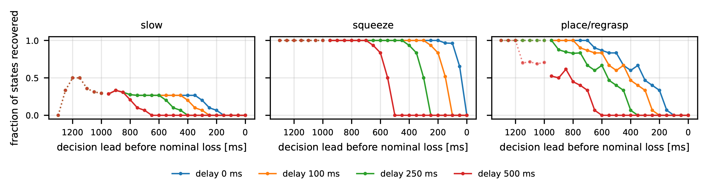
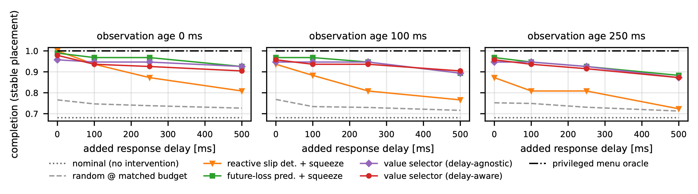
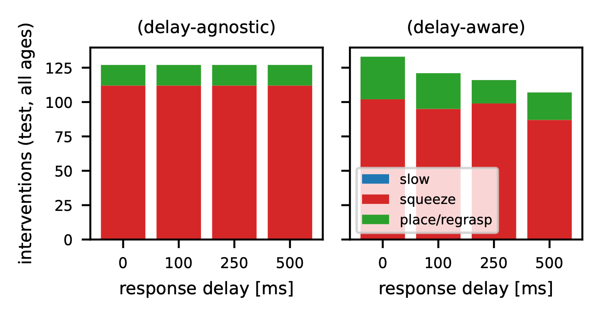
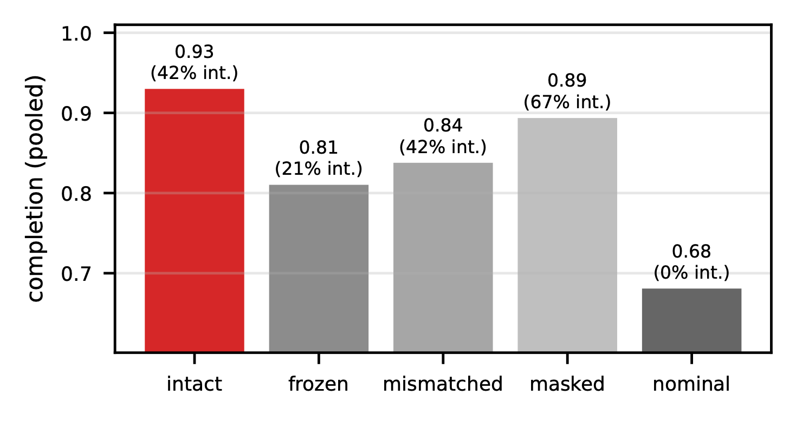
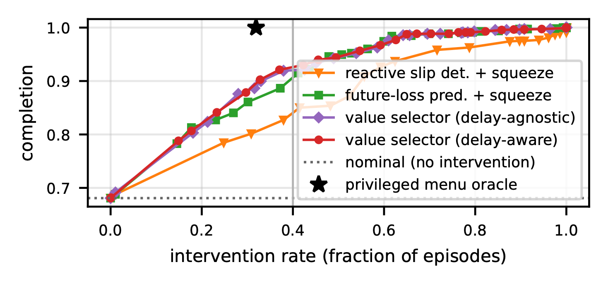

# Grasp Recovery under Delayed Feedback

**When a grasp starts to fail, which fix is still worth trying, and for how long, given that the robot's evidence is stale and its reaction is late?**

A standalone MuJoCo study that measures the value of recovery actions (slow down, squeeze harder, set down and regrasp) as a joint function of the physical state, the remedy, the age of the observation the supervisor saw, and the delay before its command takes effect. Every number in the paper is a direct measurement from exact counterfactual branches, not an estimate, and every one of them can be recomputed from the files in this repository.

> **Status: preliminary.** A four-page late-breaking write-up of this pilot was submitted to the CoRL 2026 *Sim-to-Real-to-Field* workshop (non-archival, under double-blind review; the workshop is on 12 November 2026 in Austin). This is a first pilot on one object and one simulator, reported with its negative result intact. The sequel experiment is described under [What is next](#what-is-next).

---

## The question in one paragraph

Failure detectors for manipulation are judged on how accurately they raise an alarm. But an alarm is only useful while some remedy can still succeed, and each remedy needs a different amount of time: tightening the grip acts within a control step, putting the object down and picking it up again takes hundreds of milliseconds. Meanwhile the supervisor is working from sensor data that is already old (**observation age**, *a*) and its command will not act until later (**response delay**, *d*). We ask: how do *a* and *d*, separately, change the value of each remedy under hidden contact dynamics, and does a supervisor that knows its own latency choose better than one that does not?

Three claims, ordered by strength:

1. **Remedy-specific deadlines exist and shift with response delay.** A property of the task, measured without any learning. **Supported.**
2. **Conditioning on latency changes a supervisor's decisions** (when it fires, which remedy). **Supported.**
3. **Conditioning on latency completes more tasks at a matched intervention budget.** **Not supported** in this task: −1.6 points vs. a simple future-loss-then-squeeze baseline, 95 % CI [−3.5, −0.2]; −0.4 [−1.8, +0.8] vs. the same model without latency inputs.

## How it works

```
 hidden condition          nominal controller               exact snapshots           12 counterfactual futures
 mass, friction,     →   approach, grasp, lift,       →   every 50 ms during     →   3 remedies × 4 delays,
 grasp offset, push       carry, lower, release             lift and carry              each run to its ending
                                                                                        (placed / lost / ...)
                                                             7,394 states                   88,728 branches
```

1. **Simulate** 400 pick–carry–place episodes in MuJoCo with a force-bounded parallel-jaw gripper. Each episode draws a hidden mass (0.15–0.50 kg), friction (0.35–0.80), grasp offset (±8 mm) and a hidden shove during the carry. About a third of acquired grasps are lost.
2. **Branch** from every control step during lift and carry. MuJoCo's full state is saved and restored bit-exactly (verified by test), so from each frozen moment we play out slow / squeeze / place-regrasp after 0, 100, 250 and 500 ms of delay. The parent episode's own future is the "continue" branch.
3. **Train supervisors** that see only what a real gripper senses (joint states, finger forces, wrist force/torque; no object pose, no camera), with the observation deliberately aged by *a*. Variants: reactive slip detector, future-loss predictor, per-remedy value selector with and without (*a*, *d*) inputs, random at matched rate, privileged oracle.
4. **Evaluate exactly.** With one intervention per episode, a supervisor's closed-loop outcome at (*a*, *d*) is the branch outcome of the first state where it fires, so evaluation is a table lookup. Sixty live re-simulations matched the lookup 60/60.
5. **Report with episode-clustered uncertainty.** The 12 timing cells share the same 94 test episodes, so bootstrap intervals resample episodes, not rows.

## Results

### Each remedy has its own deadline, and delay moves it



*Fraction of nominally-lost states recovered, by how far ahead of the loss the decision was made (637 states from test episodes). Squeeze needs about 50 ms of lead at zero delay; place/regrasp about 350 ms; both shift by roughly the response delay (to 550 and 850 ms at 500 ms delay). Slowing down recovers at most 22 % of lost states pooled over leads, because 77 of 100 losses begin at or after the hidden push, which slowing cannot counter. Dotted segments are bins with fewer than 20 states.*

### Anticipating failure beats reacting to it, and the gap grows with latency



*Completion on 94 test episodes per cell. A reactive slip detector falls from 1.00 (fresh evidence, no delay) to 0.72 (250 ms age, 500 ms delay). Anticipatory supervisors fall from 0.99 to 0.87. The future-loss-minus-reactive gap grows from +3.9 points [+0.4, +7.8] at zero delay to +13.5 [+7.8, +19.5] at 500 ms. The privileged oracle completes every test episode at every delay by intervening in the 30 nominally lost ones.*

| Supervisor (pooled over 12 cells) | Completion | Gain vs. nominal [95 % CI] | Intervention rate | Rescue rate |
|---|---|---|---|---|
| Nominal (never intervenes) | .681 | — | .00 | .00 |
| Random at matched rate (10 seeds) | .739 | +.058 [.039, .077] | .42 | .19 |
| Reactive slip + squeeze | .852 | +.171 [.109, .234] | .43 | .54 |
| Future-loss + squeeze | .946 | +.265 [.178, .348] | .48 | .83 |
| Value selector, delay-agnostic | .934 | +.253 [.165, .334] | .45 | .79 |
| Value selector, delay-aware | .930 | +.249 [.162, .329] | .42 | .78 |
| Oracle (privileged) | 1.000 | +.319 [.223, .415] | .32 | 1.00 |

### Latency awareness changes the decisions but not the outcome



*The delay-aware selector intervenes less often as delay grows (rate 0.472 → 0.379) and leans more on place/regrasp with old evidence; the delay-agnostic selector is constant by construction. Yet completion is indistinguishable: −0.4 points [−1.8, +0.8]. Squeeze is fast and almost always sufficient inside its deadline, so the menu collapses to "squeeze early enough", which a future-loss predictor already does. The interval rules out a benefit larger than about one point; it does not rule out zero.*

<details>
<summary>Controls: the model uses its observations, and the budget curve</summary>



*Replacing the delay-aware selector's observations at test time with frozen (−12.0 points [−17.8, −6.6]), mismatched (−9.2 [−16.8, −1.4]) or masked (−3.6 [−7.6, +0.7]) inputs degrades it, so it is reading the sensors, not just the timing inputs. On a held-out friction band (0.50–0.58, never seen in training) the ordering of the anticipatory supervisors reshuffles within a point or two, confirming they are equivalent here.*



*Sweeping the decision threshold: the anticipatory supervisors stay within 3.5 points of each other up to a 60 % intervention rate, and none reaches the oracle below a 99 % rate.*

</details>

## What is next

The thesis is under-tested because squeezing is cheap. The sequel makes it costly: a hidden crush limit (fragile objects) or a gripper already near its force bound, so that squeeze can fail or cause damage and the choice between remedies carries real weight. Also planned: measured latency traces from a real inference stack in place of fixed delays, more object geometries and a second disturbance type, an intervention duration/cost analysis, and then matched trials on a physical arm.

## Repository map

```
src/delayed_recovery/
  assets/gripper_transport.xml  Cartesian carrier + force-controlled parallel-jaw gripper + cube
  config.py                     task constants, timing grid, hidden-physics sampling, remedies, outcomes
  env.py                        MuJoCo env; deployable vs privileged views; bit-exact snapshot/restore
  controller.py                 nominal phase machine + remedy menu (deployable inputs only)
  episode.py                    episode runner, outcome labels, matched branching, live supervisor hook
  collect.py                    parent episodes × decision states × remedy × delay branch tables
  dataset.py                    stale-observation features, labels, episode-level splits
  selectors.py                  nominal, reactive, future-loss, value (agnostic/aware), random, oracle, nulls
  evaluate.py                   exact closed-loop evaluation by lookup, budgets, cluster bootstrap, frontier
scripts/
  collect_branches.py           generate the data (multiprocess, ~6 min on 9 cores)
  run_pilot.py                  fit, choose thresholds on validation, evaluate on test → report.json + CSV
  verify_lookup.py              re-simulate selector-driven episodes live and compare with the lookup
  export_intervals.py           recompute every clustered interval from the CSV alone → intervals.{json,md}
  make_figures.py               paper figures from report.json
tests/                          20 tests: exact replay, label semantics, causality, selector semantics
paper/                          main.tex (anonymised, IEEE two-column) + figures
results/pilot_v1/               report.json, episode_cell_outcomes.csv, intervals.md, lookup_verification.json
runs/pilot_v1/branches/         the 400 raw per-episode branch files (~3 MB) so nothing needs re-simulating
docs/                           SYSTEM_DESIGN.md, PAPER_NOTES.md, proposal, project separation
```

Documentation:

* [docs/SYSTEM_DESIGN.md](docs/SYSTEM_DESIGN.md): thesis, claims, every design decision and its rationale, pilot verdicts.
* [docs/PAPER_NOTES.md](docs/PAPER_NOTES.md): writer's notes; every number and interval, the test behind each decision, verified references, audit history, submission checklist.
* [docs/GRASP_RECOVERY_UNDER_DELAYED_FEEDBACK.md](docs/GRASP_RECOVERY_UNDER_DELAYED_FEEDBACK.md): original proposal and prior-work boundaries.
* [results/pilot_v1/intervals.md](results/pilot_v1/intervals.md): all 20 comparisons, pooled / per delay / per age / per cell.

## Reproduce

```bash
uv venv --python 3.12 .venv && source .venv/bin/activate
uv pip install -e . pytest
pytest -q                                                                                    # ~15 s
python scripts/collect_branches.py --n 400 --seed 0 --workers 9 --out runs/pilot_v1/branches   # ~6 min
python scripts/run_pilot.py --data runs/pilot_v1/branches --out results/pilot_v1
python scripts/verify_lookup.py --data runs/pilot_v1/branches --n 60
python scripts/export_intervals.py --csv results/pilot_v1/episode_cell_outcomes.csv
python scripts/make_figures.py --report results/pilot_v1/report.json --out paper/figures
cd paper && tectonic main.tex
```

Collection is seeded and deterministic; `run_pilot.py` reproduces every point estimate exactly. The raw branch files, results and figures are committed, so the paper builds from the repository alone.

## Timing contract in one line

Observation captured at `t − a`, decision at `t`, remedy effective at `t + d`; physics never pauses and the committed plan keeps executing during `d`. Grid: `a ∈ {0, 100, 250} ms`, `d ∈ {0, 100, 250, 500} ms` at 20 Hz control, 2 ms physics.

## Scope and limits

Simulation only (MuJoCo 3, soft contacts); one rigid 4 cm cube; an ideal two-axis Cartesian carrier rather than an arm; scripted controller and remedies; deterministic physics with a single hidden push; synthetic fixed delays rather than measured latency traces; proprioception and wrist force only, no camera; 94 test episodes, which resolve pooled differences of roughly two points and no finer. Snapshot exactness is a property of the evaluation protocol, not evidence of robustness or transfer. No energy, damage, hardware or field claims are made.

This project is independent of the author's `grasp-failure-recovery` repository; no code, assets or data are shared ([docs/PROJECT_SEPARATION.md](docs/PROJECT_SEPARATION.md)).

## Prior work this builds on

RESCUE (arXiv:2610.13516) and CheckVLA (arXiv:2607.26789) established that detection accuracy does not imply intervention value and that recoverability depends on the repair set; PREFAIL (arXiv:2607.16921) labels the last actionable stop time in lift-and-place; Reflex/ReflexBench (arXiv:2608.14379) benchmarks reaction-critical policies under inference latency; real-time chunking (arXiv:2506.07339) handles delayed policy execution. This study takes the detection/intervention distinction as given and asks what sets the width of the gap: the remedy and the latency, separately.
